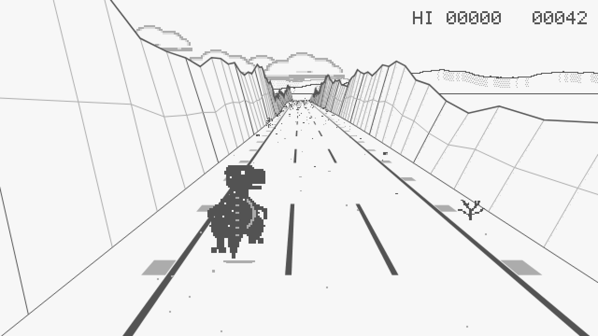

# 🦖 DINO: HORIZON

**The Chrome T-Rex runner, reimagined in 3D.**
Same monotone pixel style. Same 8-bit beeps. New dimension: the dino now runs *into* the horizon through a canyon, jumping cacti and switching lanes to dodge deep cracks in the road.

### ▶️ [Play in your browser](https://lagharimoosakhan-ops.github.io/dino-horizon/)



## Controls
| Action | Keyboard | Touch |
|---|---|---|
| Jump | `Space` / `↑` / `W` | Tap |
| Change lane | `←` `→` / `A` `D` | Swipe |
| Mute | `M` | — |

## Features
- Pseudo-3D perspective engine written in plain JavaScript on a single `<canvas>`, with no libraries
- Pixel sprites drawn in code and snapped to the original 4-tone grey palette
- Three lanes, cacti to jump, and cracks you can only avoid by changing lanes (one lane is always open)
- Procedural canyon walls, parallax mountain ranges, dust, debris and screen shake
- Speed ramps up, the score flashes every 100 points, and the game switches to night mode every 700 points
- 8-bit sound effects made with the Web Audio API
- High score saved locally, and it works offline

## Chrome / Edge extension
Run it from your toolbar with **Alt+Shift+D**.
1. Download [`dino-horizon-extension.zip`](assets/dino-horizon-extension.zip) and unzip it, or use the [`extension/`](extension) folder.
2. Open `chrome://extensions` (or `edge://extensions`) and turn on **Developer mode**.
3. Select **Load unpacked** and choose the folder.

## Project structure
```
index.html        → the full game (hosted on GitHub Pages)
extension/        → Manifest V3 Chrome extension
assets/           → screenshots + packaged extension zip
```

## Credits
Inspired by Google Chrome's offline T-Rex game. This is an independent fan project, not affiliated with Google.

Built by **Muhammad Moosa Laghari** · [LinkedIn](https://www.linkedin.com/in/mohammed-moosa-laghari-383ab1ab/)
